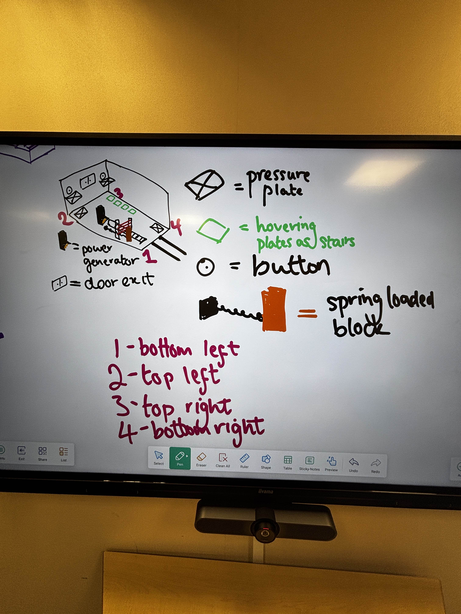

# Chamber 3: "All Hands"

**Purpose:** The first big room. The player has to build a large team of afterimages, each one doing a different job, to power the room and reach the exit.

**Mechanics taught:**
- Afterimages can hold an object in place, not just a button or plate
- Combining several afterimages, each with its own job (4 required)
- Afterimages can ride moving platforms (the hovering stair plates)
- Afterimages can set up the path for later afterimages, not just for you

## Camera

Isometric, facing northwest, as in the sketch. Corners are referred to as:

| Number | Corner |
|---|---|
| 1 | Bottom left |
| 2 | Top left |
| 3 | Top right |
| 4 | Bottom right |

## Room layout

- **Entrance:** Corridor from the Chamber 2 door, coming into the bottom of the room near corner 1.
- **Power generator:** Near the middle of the room. Needs a fuel source to run. When it's powered, the room becomes powered.
- **Conveyor belt:** Carries fuel into the power generator.
- **Laser wall:** Crosses the conveyor belt and burns the fuel before it reaches the generator.
- **Hydraulic block:** Next to the laser wall. It can be pushed into the laser field to block the lasers, but it doesn't stay there on its own. Something has to hold it in place. (Originally a spring-loaded block. Hydraulic is the current preference.)
- **Bottom right pressure plate (floor, near corner 4):** Flips up the hovering stair plates so they become stairs.
- **Hovering stair plates:** A row of 4 plates near corner 3. When flipped up they act as stairs. They can move between the right side, the left side and the middle.
- **Top right button and pressure plate (raised, on the back wall near corner 3):** Reached by the stairs. The pressure plate here moves the hovering plates to the left side.
- **Top left button and pressure plate (raised, on the back wall near corner 2):** Reached by the stairs once they've moved left. Moves the stairs to the middle.
- **Exit door (raised, middle of the back wall):** Reached by the stairs once they're in the middle.

> **Note:** The floor pressure plate in the top left of the sketch (near corner 2) was drawn by mistake and isn't part of the level.

## Step-by-step flow

1. **Enter.** The player walks in from Chamber 2 into a huge room.
2. **Spot the problem.** Fuel travels along the conveyor belt towards the power generator but gets burnt by the laser wall.
3. **Block the lasers (Afterimage 1).** Push the hydraulic block into the laser field and hold it there. This run becomes Afterimage 1, which keeps holding the block so it stays in the lasers' way.
4. **Power the room.** With the lasers blocked, fuel reaches the generator and the room gets powered.
5. **Raise the stairs (Afterimage 2).** Stand on the bottom right pressure plate. The hovering plates flip up and become stairs. This run becomes Afterimage 2, which keeps standing on the plate.
6. **Top right (Afterimage 3).** Climb the stairs and go to the top right pressure plate, then hold the button. This run becomes Afterimage 3.
7. **Ride the stairs left (Afterimage 4).** Stay on the stairs behind Afterimage 3. When Afterimage 3 is on the top right pressure plate, the hovering plates move to the left side, carrying you with them. Press the top left button and pressure plate. This moves the stairs to the middle. This run becomes Afterimage 4.
8. **Exit.** With all four afterimages doing their jobs, the final you climbs the stairs in the middle and goes through the now open door. Chamber complete.

## Afterimage breakdown

| Afterimage | Job | What it unlocks |
|---|---|---|
| 1 | Holds the hydraulic block in the laser field | Fuel reaches the generator and the room is powered |
| 2 | Stands on the bottom right pressure plate | Hovering plates flip up into stairs |
| 3 | Climbs the stairs, stands on the top right plate and holds the button | Stairs move to the left side |
| 4 | Rides the stairs left, then presses the top left button and plate | Stairs move to the middle |
| Final you | Climbs the middle stairs | Reaches the open door |

**Total afterimages required:** 4

## Teaching beats

| Moment | What the player learns |
|---|---|
| Fuel burnt by the laser wall | Read the room: find what's stopping the machine from working |
| Hydraulic block won't stay in place | Some objects need an afterimage to hold them, not just push them |
| Room powers up | Solving one problem can power the rest of the room |
| Plates flip into stairs | Pressure plates can change the layout of the room |
| Afterimage 4 riding the stairs | Afterimages can travel on moving parts of the level |
| Each afterimage relying on the one before | A big team where every member has a job |
| Final you walking up to the door | Clear payoff, chamber complete |

## Art and feedback notes

- **Power generator:** Should fit the dystopian, broken-world look. For example, a heavy, worn industrial furnace that's been patched up over time: rusted panels, exposed pipes and cabling, a fuel intake fed by the conveyor belt, and a glow or flicker that's weak or dark when unpowered.
- **Powering on:** A clear change across the whole room when the generator starts (lights coming on, machinery starting up), so the player knows the first problem is solved.
- **Laser wall vs fuel:** Fuel getting burnt by the lasers should be easy to see, since it's how the player works out the problem.
- **Hydraulic block:** Should show that it pushes back or retracts when let go, so the player understands it needs to be held.
- **Hovering plates:** Their movement (flipping up, sliding left, sliding to the middle) should be readable from the isometric camera.
- **Raised buttons and plates:** Need to be clearly visible from the floor so the player knows the stairs are there to reach them.

## Decisions

- **Power controls everything:** without power the plates, stairs and exit door do nothing. Power
  stays on only while fuel keeps arriving, so if Afterimage 1 lets go of the block, the room loses
  power and everything after it unravels.
- **Plates, not buttons:** each raised button and plate pair works by standing on the plate; the
  buttons are decoration.
- **Raised balcony:** the plates by the back wall and the exit door sit on a balcony one wall-block
  high, split into three bays by pillars. Its front edge is solid except where the raised stairs
  stand; the 4 plates flip up into 4 steps leading onto it, with rails so you only get on at the
  bottom and off at the top. Characters on the balcony or the steps are drawn at that height.
- **Hydraulic mechanism:** a fixed base pushes the block out on a piston arm along a floor channel
  until it caps the laser lens. A pedal on the floor drives it; let go and the block springs back
  against the base.
- **Visible wiring:** cables run from the generator to every plate and the exit door and light up
  when the room is powered. Each plate has its own cable to what it moves (pedal → piston, plates →
  the stairs' stops), and a stop's floor marker lights up when the stairs will go there.
- **Fuel:** a steady stream of crates, one about every 1.2 seconds.
- **Exit door:** opens when the player walks up to it while the room is powered.
- **Afterimage 4's timing:** it boards the stairs once they flip up; they only slide left when
  Afterimage 3 reaches the top right plate after climbing, which gives Afterimage 4 time to get on.

## Open questions

- What should the fuel and the generator look like in the final art?
