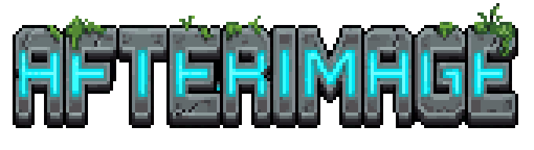

  

  <b>An isometric pixel-art puzzle game about cooperating with your own past.</b> 
  Made in 24 hours for the University of Bristol Game Jam 2026. Theme: <i>Time</i>.

<!--
  Add screenshots and a GIF to docs/media/ and uncomment:

  

    
  

  

     
  

-->

## About

As children, you and your sister were test subjects in a secret laboratory. The experiments left you with a strange gift: an implant in your arm that records everything you do and lets you replay it as an **afterimage** of yourself. You escaped. Your sister did not. Now you break back into the deserted, overgrown facility, full of half-broken relic tech, to find her.

Save a run and an afterimage of you replays it on every new attempt, so one person can end up in several places at once.

Each chamber is a puzzle built around that idea: hold a plate down with one clone while another walks through a door, send a clone ahead to absorb a laser shot, or feed a generator before your own run begins. Five chambers take you from learning the basics to a final scene you probably should not trust.

## How it plays

1. Move around the chamber and try something. The camera stays close and you only see a small pool of light, so hold **Tab** for a live map of the room and every clone.
2. Press **R** to save the run into your current clone and restart. Everything you did is replayed, tick for tick, by that clone on the next attempt.
3. Press **T** to throw the run away and retry, or **F** to mark a run so that dying saves it. That is how you send a clone ahead to take a hit.
4. Keys **1-5** pick an earlier clone to re-record while the others keep replaying.

| Chamber | What it teaches |
| --- | --- |
| Tutorial 1 | Buttons, doors and your first clone |
| Tutorial 2 | Charging lasers, death and sacrificing a clone |
| Chamber 3 | A fuel belt, generator and hydraulic block that depend on clones holding things in place |
| Chamber 4 | Jumping, ladders, a scanner and timed rising platforms |
| Ending | The trap |

## Controls

| Action | Key |
| --- | --- |
| Move | WASD or arrow keys |
| Interact | E |
| Jump (Chamber 4 onward) | Space |
| Save run as a clone and restart | R |
| Retry without saving | T |
| Mark run so dying saves it | F |
| Choose which clone to control | 1-5 |
| Chamber map | Hold Tab |
| Pause and settings | Esc |

Gameplay keys can be rebound from the pause menu's Settings page.

## Running the project

Requires **Unity 6** (`6000.6.8f1`).

1. Clone the repository and open the folder in Unity Hub.
2. Open `Assets/_Project/Scenes/Title.unity` and press **Play**. The menu item **GameJam > Play From Title** (on by default) makes Play start from the title screen whichever scene is open.
3. To build, use **File > Build Profiles** (Windows standalone). The scenes are already in Build Settings in play order.

`Edit > Clear All PlayerPrefs` resets the Continue save, key rebinds and settings.

## Project layout

- `Assets/_Project/Scenes/`: the six scenes (Title, Tutorial1, Tutorial2, Chamber3, Chamber4, Ending)
- `Assets/_Project/Scripts/`: gameplay code, grouped by feature (`Afterimage`, `Core`, `Player`, `Interactables`, `Hazards`, `Machines`, `UI`, `Visuals`, `Audio`, `Story`, `Editor`)
- `Assets/_Project/Art/`, `Audio/`, `Prefabs/`, `Data/`: content
- `Ideas/`: the original design notes, per-level designs and sketches
- `CLAUDE.md`: a deeper tour of the architecture and conventions
- `CREDITS.md`: asset sources and tools

## Under the hood

- **Deterministic record and replay.** A shared fixed-step tick clock drives everything that matters. The player's position, facing, interactions and jumps are recorded per tick, and each clone replays its recording on the same tick, so clones behave identically every attempt.
- **True 2:1 isometric** HD pixel art (64 px per unit) with Y-sorted tilemaps, per-tile wall fading and visual-only elevation over flat physics.
- **URP 2D lighting** with a near-black ambient light, so lamps, glows and the character's own light do all the guiding.
- **Event-driven audio, game feel and UI**: one-job bridge scripts listen to gameplay events, so none of it can affect the puzzles.

## Credits

Built by a team of three for the Bristol Game Jam. The pixel art was generated with [PixelLab](https://pixellab.ai) and the sound effects and music with [ElevenLabs](https://elevenlabs.io) (plus a synthesised credits track). Code was written with the help of Claude Code. See [`CREDITS.md`](CREDITS.md) for details and licences.
