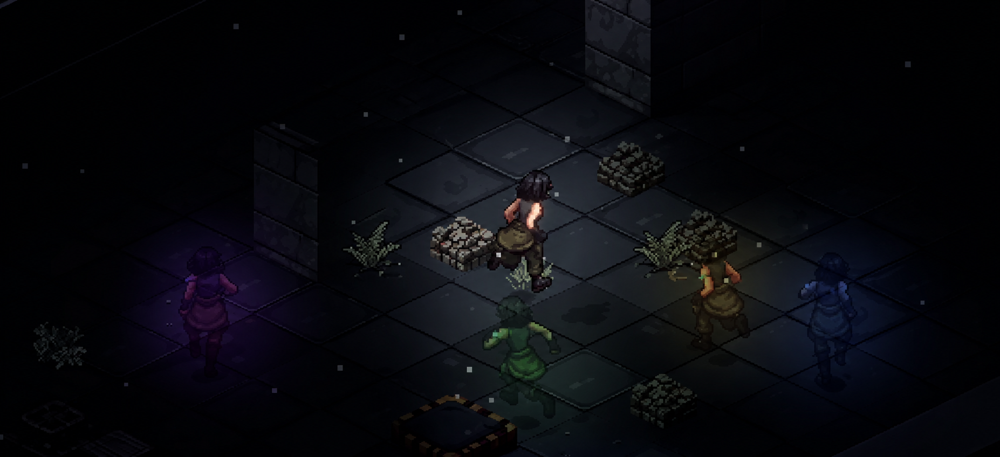

  

  <b>An isometric pixel-art puzzle game about cooperating with your own past.</b> 
  Made in 24 hours for the University of Bristol Game Jam 2026. Theme: <i>Time</i>.

  

## About

As children, you and your sister were test subjects in a secret laboratory. The experiments left you with a strange gift: an implant in your arm that records everything you do and lets you replay it as an **afterimage** of yourself. You escaped. Your sister did not. Now you break back into the deserted, overgrown facility, full of half-broken relic tech, to find her.

Save a run and an afterimage of you replays it on every new attempt, so one person can end up in several places at once.

Each chamber is a puzzle built around that idea: hold a button down with one clone while another walks through a door, send a clone ahead to absorb a laser shot, or feed a generator before your own run begins. Four chambers take you from learning the basics to operating 5 different afterimages simultaneously. 

## Controls

| Key | Action |
| --- | --- |
| **WASD** / arrows | Move |
| **E** | Interact |
| **Space** | Jump (Chamber 4 onward) |
| **R** | Save the run into your current clone and restart. That clone replays everything you did, tick for tick, on the next attempt |
| **T** | Throw the run away and retry |
| **F** | Mark a run so that dying saves it. That is how you send a clone ahead to take a hit |
| **1-5** | Pick an earlier clone to re-record while the others keep replaying |
| **Tab** (hold) | Live chamber map (graphics unfinished) |
| **Esc** | Pause menu and settings |

Gameplay keys can be rebound from the pause menu's Settings page.

## Running the project

Requires **Unity 6** (`6000.6.8f1`).

1. Clone the repository and open the folder in Unity Hub.
2. Open `Assets/_Project/Scenes/Title.unity` and press **Play**. The menu item **GameJam > Play From Title** (on by default) makes Play start from the title screen whichever scene is open.
3. To build, use **File > Build Profiles** (Windows standalone). The scenes are already in Build Settings in play order.

## Project layout

- `Assets/_Project/Scenes/`: the six scenes (Title, Tutorial1, Tutorial2, Chamber3, Chamber4, Ending)
- `Assets/_Project/Scripts/`: gameplay code, grouped by feature (`Actors`, `Afterimage`, `Core`, `Player`, `Interactables`, `Hazards`, `Machines`, `UI`, `Visuals`, `Audio`, `Story`, `Editor`)
- `Assets/_Project/Art/`, `Audio/`, `Prefabs/`, `Data/`: content
- [`docs/`](docs/README.md): design documents (game design, story, UI, audio and one file per level) and the original sketches
- [`CLAUDE.md`](CLAUDE.md): a deeper tour of the architecture and conventions
- [`LICENSE`](LICENSE): MIT licence for the code

## Credits

Built by a team of three for the Bristol Game Jam. The pixel art was generated with [PixelLab](https://pixellab.ai) and the sound effects and music with [ElevenLabs](https://elevenlabs.io) (plus a synthesised credits track). Code was written with the help of Claude Code.

## Licence

The source code is released under the [MIT Licence](LICENSE). The art and audio were generated with third-party tools and are used under those tools' terms.
