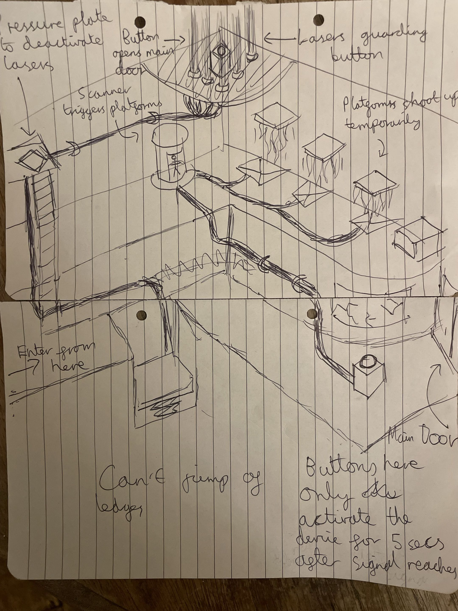

# Chamber 4: "Leap of Faith"

**Purpose:** A timing room. One afterimage opens a short window for another, and the player learns to jump.

**Mechanics taught:**
- One afterimage's button press opens a **timed window** that a different afterimage has to use
- An afterimage **holding** a plate can power two things at once (a lift and the guard lasers)
- **Jumping** (new in this chamber; no earlier chamber has it) between platforms that rise one after another
- **Climbing** a ladder to a ledge

## Camera

Isometric, as in the sketch. Positions are given as they appear on screen (bottom-left, top-centre and so on).

## Room layout

| Zone | Where | Contents |
|---|---|---|
| A Entrance | Bottom-left | The player enters here. A ladder runs up the left wall to the plate ledge (E). Nobody can jump or walk off a ledge. |
| Dip | Between A and B | A missing strip of floor. The **dip platform** sits at the bottom of the gap on a scissor-lift (a lattice, like a cherry picker). While the plate is held, the lift extends and pushes the platform up to floor level as a bridge. When the plate is released, it folds back down. |
| B Button area | Bottom-right | The **signal button** on a pedestal, a cable to the scanning chamber, and the **exit door** in the right wall. |
| C Scanning chamber | Centre | An entry door, the **scanner** (a glass tube) inside, and a far-side opening onto the chasm (F). |
| E Plate ledge | Top-left, at the top of the ladder | The **pressure plate**, with cables to the dip lift and to the guard lasers. |
| F Chasm | Right / back | **Rising platforms** in a row, each one higher than the last, with gaps between them. |
| G Top ledge | Top-centre | The **top button**, ringed by constant **guard lasers**. Its wire runs to the exit door. |

The box on the right and the overgrowth under the top button are props.

## Interactables

- **Pressure plate:** on only while someone stands on it. Raises the dip lift and switches the guard lasers off.
- **Signal button:** a normal button. Its signal travels down the wire (as in Tutorial1). When the signal reaches the scanning chamber, the chamber door opens for **5 seconds**, then closes.
- **Scanner:** standing inside for about **1 second** completes a scan. That opens the far side of the chamber and sends a signal to the rising platforms.
- **Rising platforms:** after a scan they shoot up one after another, and each drops again after a while. You jump from one to the next as they come up. Anyone on a platform when it drops falls and dies.
- **Guard lasers:** constant beams around the top button that kill anyone who walks in. They are off only while the pressure plate is held.
- **Top button:** opens the exit door.

## Step-by-step flow

1. **Enter.** The player arrives at the bottom-left and sees the gap, with the button area and exit door beyond it.
2. **Hold the plate (Afterimage 1).** Climb the ladder and stand on the pressure plate. The lift pushes the dip platform up into a bridge, and the guard lasers around the top button switch off. This run becomes Afterimage 1, which keeps standing on the plate.
3. **Press the signal button (Afterimage 2).** Cross the bridge and press the button in the bottom-right. The signal travels to the scanning chamber, and its door opens for 5 seconds. This run becomes Afterimage 2.
4. **Scan and climb (Afterimage 3).** Wait by the scanning chamber, go in while the door is open and stand in the scanner. The platforms start rising one after another ("Oh wait, I can jump!"). Jump up them before each one drops, reach the top ledge, and press the top button. The exit door opens. This run becomes Afterimage 3.
5. **Exit.** With all three afterimages replaying, the final you crosses the bridge and leaves through the exit door. Chamber complete.

The button is far enough from the scanning chamber that one person can't press it and still get in before the door shuts. That is why steps 3 and 4 need two different afterimages.

## Afterimage breakdown

| Afterimage | Job | What it unlocks |
|---|---|---|
| 1 | Climbs the ladder and stands on the pressure plate | Dip bridge up and guard lasers off |
| 2 | Crosses the bridge and presses the signal button | Scanning chamber open for 5 s once the signal arrives |
| 3 | Gets scanned, jumps up the rising platforms and presses the top button | Exit door open |
| Final you | Crosses the bridge to the exit | Chamber complete |

**Total afterimages required:** 3 (the clone limit is 4).

## Timings (tunable in playtests)

| What | Value |
|---|---|
| Scanning chamber door open after the signal arrives | 5 s (250 ticks) |
| Time in the scanner to complete a scan | 1 s (50 ticks) |
| Delay between each platform rising | 50 ticks |
| How long each platform stays up | 100 ticks |
| Jump | about 1.5 cells in the facing direction |

## Controls

- **Jump:** Space (rebindable). Not available in any earlier chamber. When the player first needs it, a hint pops up: "Oh wait, I can jump!" with the key.
- **Ladder:** walk into it to climb; walk off the top onto the ledge.

## Art and feedback notes

- **Dip lift:** a scissor-lift lattice that unfolds out of the gap and pushes the platform up to floor level, then folds back down. The motion should read clearly from the iso camera.
- **Scanning chamber:** a glass tube with a light sweep while scanning; the door should show it is about to close (flashing light) near the end of its 5 seconds.
- **Rising platforms:** they shoot up from the chasm one after another, with a warning flicker before each one drops.
- **Guard lasers:** clearly on or off, with a cable from the plate that lights while the plate is held.
- **Animations:** the player and the clones need climbing and jumping animations.

## Decisions

- **Scanning chamber door:** anyone standing in its doorway when it closes is killed.
- **Rising platforms:** five one-row platforms, every other row, rising in 0.6 steps from 1.5 to 3.9 cells high. The 2-cell jump reaches the next one.
